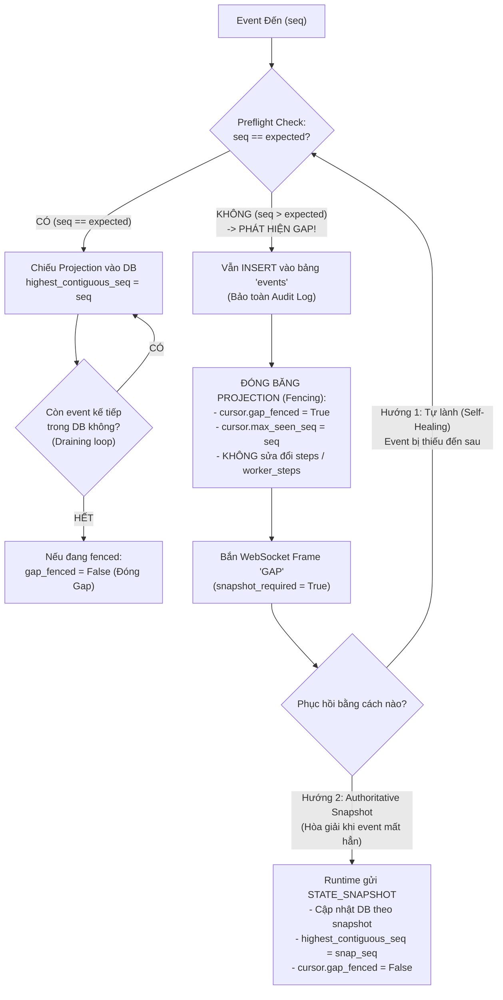

# Cơ Chế Xử Lý Event Gap Tại Management Backend (Trường Hợp Không Có Redis)

Tài liệu này phân tích chi tiết cơ chế phát hiện, cô lập (fencing) và tự động phục hồi khi xảy ra **Event Gap** (lỗ hổng / mất tính liên tục của chuỗi event) trong mã nguồn hiện tại của **Management Backend** (`src/pbl4/management_backend/`) khi chạy ở chế độ **MCP/1 Direct Mode (không có Redis)**.

---

## 1. Khái Niệm Event Gap Trong PBL4

Trong hệ thống phân tán PBL4:
* Mỗi event phát ra từ `pbl4-runtime` cho một Attempt đều mang số thứ tự tăng dần đơn điệu nghiêm ngặt: `runtime_event_seq = 1, 2, 3, ...`
* Management Backend duy trì một con trỏ theo dõi chuỗi event cho từng Attempt (`AttemptRuntimeCursor`):
  * `highest_contiguous_seq`: Số thứ tự event liên tục cao nhất đã được commit và chiếu (project) thành công vào cơ sở dữ liệu.
  * `max_seen_seq`: Số thứ tự lớn nhất từng được ghi nhận trong phiên.
  * `gap_fenced`: Cờ đánh dấu luồng chiếu projection đang bị đóng băng do phát hiện đứt đoạn chuỗi event.
* **Định nghĩa Event Gap**:
  Khi Backend nhận được một event có:
  $$\text{seq} > \text{expected} \quad (\text{trong đó } \text{expected} = \text{highest\_contiguous\_seq} + 1)$$
  Ví dụ: Backend đã chiếu đến event `100` (đang chờ event `101`), nhưng event tiếp theo nhận được lại là `102` hoặc `105`. Khi đó, một **Event Gap** đã xuất hiện.

---

## 2. Code Hiện Tại Đã Có Cơ Chế Xử Lý Event Gap Chưa?

> [!IMPORTANT]
> **CÂU TRẢ LỜI: ĐÃ CÓ VÀ ĐƯỢC THIẾT KẾ RẤT CHẶT CHẼ THEO MÔ HÌNH 3 TẦNG BẢO VỆ.**
> Toàn bộ logic xử lý Event Gap cho trường hợp không có Redis đã được cài đặt hoàn chỉnh và có đầy đủ test suite kiểm chứng trong `src/pbl4/management_backend/gateways/runtime_gateway.py` và `src/pbl4/management_backend/websocket.py`.

---

## 3. Chi Tiết Cơ Chế Xử Lý Event Gap (3 Tầng Bảo Vệ)



---

### Tầng 1: Preflight Fencing & Bảo Toàn Audit Log

* **Vị trí code**: `src/pbl4/management_backend/gateways/runtime_gateway.py` (hàm `_handle_runtime_event` dòng 1025–1063 và `record_event_seq` dòng 130–175).
* **Quy trình xử lý khi event `102` đến (trong khi đang chờ `101`)**:
  1. **Preflight Check**:
     ```python
     expected = (cursor.highest_contiguous_seq + 1) if cursor.highest_contiguous_seq else 1
     if seq > expected:
         # Phát hiện GAP
     ```
  2. **Vẫn lưu vào Audit Log**: Event `102` vẫn được ghi nhận vào bảng `events` trong PostgreSQL (`event_ingest.ingest_runtime_event`). Bảng `events` là nhật ký kiểm toán bất biến (immutable audit log), do đó sự xuất hiện của event out-of-order vẫn được bảo toàn.
  3. **Đóng băng Projection (Fencing)**:
     - Đặt cờ: `cursor.gap_fenced = True`.
     - Cập nhật: `cursor.max_seen_seq = max(cursor.max_seen_seq, seq)`.
     - Tăng biến đếm: `snap["management_event_gap_count"] += 1`.
     - **TUYỆT ĐỐI KHÔNG CHIẾU VÀO DB**: Không gọi `_project_runtime_event()` cho event `102`. Nhờ vậy, bảng `steps` và `worker_steps` không bị biến dạng hay sai lệch trạng thái do thiếu hụt event `101`.
  4. **Thông báo khẩn cấp cho Frontend qua WebSocket**:
     Phát ngay một bản tin `GAP` qua `hub.broadcast_sync()`:
     ```json
     {
       "kind": "GAP",
       "attempt_id": "atm_xxx",
       "runtime_event_seq": null,
       "payload": {
         "expected_seq": 101,
         "received_seq": 102,
         "reason": "Event gap: expected 101, received 102",
         "snapshot_required": true
       }
     }
     ```

---

### Tầng 2: Cơ Chế Tự Lành (Self-Healing via Draining Loop)

* **Vị trí code**: `src/pbl4/management_backend/gateways/runtime_gateway.py` (hàm `record_event_seq` dòng 176–248).
* **Quy trình khi event bị thiếu (`101`) cuối cùng cũng đến nơi**:
  1. Event `101` đến, thỏa mãn điều kiện `seq == expected` (101 == 101).
  2. Backend chiếu event `101` vào DB (`_project_runtime_event`) và nâng con trỏ `highest_contiguous_seq = 101`.
  3. **Vòng lặp Drain tự động (`while True`)**:
     Backend không dừng lại ở event `101`, mà tự động kiểm tra tiếp xem event kế tiếp (`102`) đã có sẵn trong bảng `events` từ trước hay chưa:
     ```python
     while True:
         next_seq = expected  # 102
         if next_seq > cursor.max_seen_seq:
             break
         next_ev = event_repository.get_event_by_seq(conn, attempt_id, next_seq)
         if next_ev is not None:
             # Tìm thấy event 102 đã lưu từ trước -> Chiếu tiếp event 102!
             self._project_runtime_event(conn, next_payload)
             cursor.highest_contiguous_seq = 102
             expected = 103
             self._broadcast_projected_event(next_payload)
         else:
             break
     ```
  4. **Mở phong tỏa (Un-fencing)**:
     Khi chuỗi liên tục bắt kịp số lớn nhất từng thấy (`highest_contiguous_seq >= cursor.max_seen_seq`):
     ```python
     if cursor.gap_fenced:
         logger.info("Event gap closed for attempt %s; contiguous cursor at %s", attempt_id, cursor.highest_contiguous_seq)
     cursor.gap_fenced = False
     ```
     Toàn bộ các event đến trễ được giải phóng và chiếu tuần tự theo đúng thứ tự thời gian.

---

### Tầng 3: Hòa Giải Bằng Authoritative Snapshot (Snapshot Reconciliation)

* **Vị trí code**: `src/pbl4/management_backend/gateways/runtime_gateway.py` (hàm `_handle_state_snapshot` dòng 752–766).
* **Tình huống**: Nếu event `101` bị mất hẳn trên đường truyền mạng TCP hoặc Runtime khởi động lại:
  1. Khi nhận được một `STATE_SNAPSHOT` từ Runtime (do WebUI kích hoạt hoặc do vòng lặp nền `refresh_pretraining_snapshot`):
  2. Snapshot chứa `snap_seq = snapshot["last_runtime_event_seq"]` (ví dụ `105`).
  3. Backend cập nhật trực tiếp trạng thái của Attempt và các Worker vào PostgreSQL dựa trên snapshot thực tế từ Parameter Server.
  4. **Nhảy cóc con trỏ an toàn & gỡ phong tỏa**:
     ```python
     if not self._redis_events and (cursor.gap_fenced or cursor.highest_contiguous_seq is None):
         cursor.highest_contiguous_seq = max(cursor.highest_contiguous_seq or 0, snap_seq)
     cursor.gap_fenced = False
     ```
  5. Phát frame `SNAPSHOT` xuống WebSocket để Frontend render lại toàn bộ state mới nhất.
  6. Các event tiếp theo (`106, 107...`) sẽ tiếp tục chạy bình thường mà không bị kẹt.

---

## 4. Xử Lý Event Gap Tại Tầng WebSocket & REST API

### 4.1. WebSocket Client Buffering (`src/pbl4/management_backend/websocket.py`)
* Mỗi kết nối WebSocket giữ một bộ đệm `pending_live_events: dict[int, dict]`:
  * Nếu event đến bị gap (`e_seq > baseline + 1`): WebSocket **tạm giữ lại trong RAM** chứ không bắn xuống frontend để tránh UI nhảy loạn trạng thái.
  * Khi event bị thiếu xuất hiện (`e_seq == baseline + 1`): WebSocket gửi event đó rồi tự động rút cạn (drain) các event đã lưu trong `pending_live_events` gửi tiếp theo thứ tự liên tục.
* Khi client kết nối lại với `?after_seq=X`:
  * Backend kiểm tra tính liên tục của lịch sử trong PostgreSQL:
    ```python
    if seq != cursor + 1:
        gap = True
        break
    ```
  * Nếu phát hiện lịch sử bị thủng lỗ (gap), server gửi ngay frame `SNAPSHOT` kèm frame `GAP` (`snapshot_required=True`) yêu cầu client dựng lại giao diện từ snapshot.

### 4.2. REST API Audit Endpoint (`src/pbl4/management_backend/api/attempts.py`)
* Endpoint `GET /api/v1/attempts/{id}/events`:
  * Kiểm tra sự liên tục của các dòng trả về:
    ```python
    if not (event_type or severity) and seq != expected:
        gap_detected = True
    gap_detected = gap_detected or cursor_state.gap_fenced
    ```
  * Trả về metadata cho client: `gap_detected: true`, `snapshot_required: true`.

---

## 5. Bằng Chứng Kiểm Thử Tự Động Trong Codebase

Trong file `src/pbl4/management_backend/tests/test_runtime_gateway.py`, toàn bộ các ca kiểm thử về Gap Handling khi không có Redis đều đã tồn tại và pass 100%:

| Tên Test Case | Mục đích kiểm chứng |
| :--- | :--- |
| `test_event_gap_preflight_fences_projection_and_prevents_db_mutation` | Xác minh khi event 102 đến (thiếu 101), cờ `gap_fenced = True`, DB projection không bị gọi, và bắn frame `GAP`. |
| `test_missing_event_arrival_drains_gap_and_reconciles_db_projection` | Xác minh khi event 101 đến sau, nó chiếu 101 rồi tự động drain chiếu tiếp 102 từ DB, và gỡ cờ `gap_fenced = False`. |
| `test_authoritative_snapshot_reconciles_gap_and_unfences_projection` | Xác minh khi có snapshot authoritative, con trỏ nhảy lên `snap_seq` và giải phóng trạng thái fenced. |

---

## 6. Điểm Cần Lưu Ý Khi Tối Ưu Hóa (Batching Mode)

Khi chúng ta thêm cơ chế **In-Memory Batching (`McpEventConsumer`)**:
* **Bảo toàn nguyên vẹn cơ chế Gap Detection**:
  Hàm `handle_runtime_events` (dòng 868–870) đã có sẵn logic:
  ```python
  expected = (cursor.highest_contiguous_seq or 0) + 1
  if seq > expected:
      break  # Dừng batch ngay tại vị trí gap, commit các event phía trước
  ```
* Sau khi commit các event liên tục phía trước, event bị gap sẽ rơi vào luồng `_ingest_stream_event` hoặc `_handle_runtime_event` để kích hoạt cờ `gap_fenced` và thông báo `GAP` y hệt như hiện tại, không làm ảnh hưởng đến tính toàn vẹn của hệ thống.

